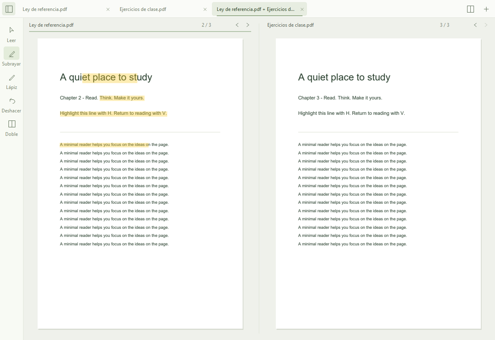

# Brisa

A minimal native PDF reader written in C++, featuring annotations, text highlighting and side-by-side document viewing.

Built for my own study sessions: simple PDF reading, without visual noise. Personal project maintained as needed.



## Use

Windows 10/11, x64. Download the portable ZIP from [Releases](https://github.com/SW3T0/brisa/releases), extract it, and run `Brisa.exe` alongside `pdfium.dll`. Open or drag in PDFs; each gets a tab. `Ctrl+D` pairs two documents in a separate workspace, with independent page navigation.

| Shortcut | Action |
| --- | --- |
| Ctrl+O | Open PDFs |
| Ctrl+1…9 / Ctrl+Tab | Switch workspaces |
| Ctrl+D / Tab | Pair documents / focus the other pane |
| Ctrl+B | Show or hide tools |
| H / P / V | Highlight text / pen / read |
| Ctrl+Z | Undo a Brisa mark |
| Ctrl+S | Save editable Brisa marks |
| Ctrl+Shift+S | Save an annotated PDF copy of the focused document |
| ← / → | Previous / next page |
| Ctrl+wheel / 0 | Zoom / fit page |
| Alt or F10 / F11 | Show menus / fullscreen |

Marks are saved automatically beside the original as `.brisa-ink`; keep both files to continue editing in Brisa. **Save annotated PDF** embeds standard highlight and ink annotations in a separate PDF, readable without Brisa or its sidecar. The original is preserved. Export captures the marks at the time saving starts; later edits require another export. Embedded annotations can be displayed, but editing existing PDF annotations is outside this MVP.

Highlighting requires selectable text; scanned pages can be marked with the pen. Pen input uses ordinary pointer events, including compatible tablets; pressure and eraser support are not implemented. Password-protected PDFs are not supported. Interface language: Spanish.

## Build

Dependencies: Windows x64, PowerShell, a C++17 compiler, and PDFium. The app uses Win32, GDI/GDI+ and PDFium, with no web runtime. It renders the visible pages on one worker thread and releases inactive page images.

With [Zig 0.15.2](https://ziglang.org/download/), from the repository directory:

```powershell
./fetch-deps.ps1
./build.ps1 -Zig 'C:\path\to\zig.exe'
./Brisa.exe
```

`fetch-deps.ps1` fetches the pinned PDFium `chromium/8076` Windows x64 package and verifies its SHA-256. Headers and third-party license notices are included; binaries are downloaded locally.

Alternatively, use CMake 3.20+ with Visual Studio C++ tools after fetching PDFium:

```powershell
cmake -S . -B build -A x64
cmake --build build --config Release
```

## License

Brisa's code is [MIT](LICENSE). PDFium and its dependencies retain their respective licenses; see [licenses](licenses). Built with assistance from an AI coding agent.
